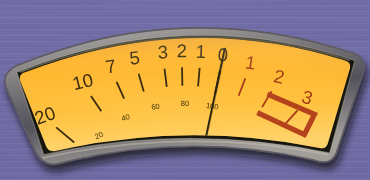
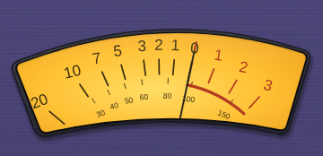
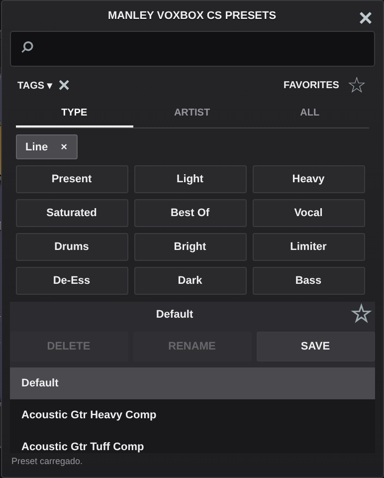
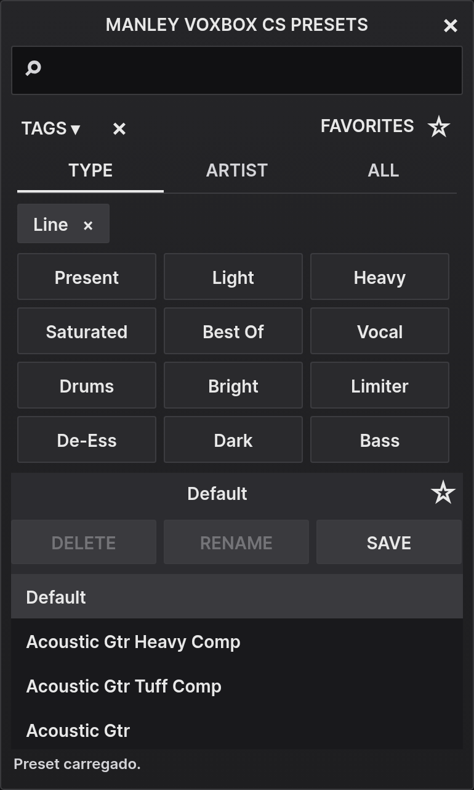

# Revisão visual da UI — valores antigos → novos

Base de comparação: commit `e56e628`, que continha o ZIP anterior publicado no GitHub. A imagem anexada nesta solicitação foi usada como REFERÊNCIA; a versão ATUAL foi renderizada a partir dessa base.

## Decisões para revisão

- O pedido textual prevaleceu onde divergia da foto: foi removido o contorno vermelho em forma de caixa e criada uma faixa curva simples.
- GAIN já tinha 64 px no código anterior. Para seguir a proporção da foto, adotou-se **52 px**, em vez de aumentar além de 64. A escala foi aproximada do corpo. Essa divergência entre “aumentar” e “seguir a proporção” foi apresentada ao usuário durante o trabalho; não houve confirmação registrada antes desta revisão.
- Mantidas **4 posições funcionais** do seletor de medição; LINE IN/G-R continuam compartilhados. Os cinco textos ficam visíveis em arco, sem criar um novo parâmetro nem alterar a medição.
- Para o roxo, foi usado o intervalo hexadecimal fornecido no pedido. Não se afirma que houve amostragem verificável do bitmap anexado: não havia um arquivo local dessa imagem acessível ao color picker.
- As imagens em `Review` permitem comparação visual. Identidade pixel a pixel com o original não foi comprovada. O DSP permanece intacto.

## VU — prioridade máxima

| Item | Antes | Depois |
|---|---|---|
| Moldura | Gradiente cinza `#B7B6B2 → #A19E9A`, corpo largo | Contorno fino escuro `#41414A → #26262E`, integrado ao painel |
| Traço externo da moldura | 1,0 unidade SVG | 0,8 unidade SVG; silhueta aproximada da abertura |
| Sombra (x / y / desvio / opacidade) | 1,5 / 4 / 2,2 / 0,72 | 0,9 / 2 / 1,3 / 0,65 |
| Sombra interna | Sem filtro de rebaixo | Desvio 0,8; opacidade 0,28, restrita à abertura |
| Caixa CSS (x, y, largura, altura) | 283, 29, 185, 89,136 px | 292, 23, 180, 86,727273 px |
| Mostrador | Gradiente linear quente | Gradiente radial: centro `#FFDC63`, meio `#FFBD2C`, bordas `#EC9411`, com vidro sutil |
| Ordem superior | 20 10 7 5 3 2 1 0 1 2 3 | Preservada; positivos 1, 2 e 3 em `#B0361B` |
| Ângulos superiores | −50, −34, −24, −16, −7, −1, 5, 12, 21, 31, 42° | Preservados e centralizados no tema |
| Fonte superior | 11 unidades SVG | 10,5 unidades SVG |
| Escala inferior | 20, 40, 60, 80, 100 | **30, 40, 50, 60, 80, 100, 150**, com ticks finos |
| Fonte inferior | 4,5 unidades SVG | 5,2 unidades SVG |
| Marca vermelha | `M159 56 L187 68 L181 80 L153 67`, 3,1 unidades | Arco aberto de 12° a 42°, raio 84, espessura 1,9; sem caixa/retângulo |
| Agulha | Traço `#29220F` | Traço fino `#242015` com ponta `#B53B22` |
| Pivô / comprimento / espessura | (110,140) / 114 / 1,1 no viewBox | Preservados, agora compartilhados entre HTML e C++ |

As formas SVG completas da abertura e moldura, cores, raios, fontes e ângulos estão em `Resources/tema-ui.json`. A agulha nativa continua recebendo a medição original; não se alteraram resposta, calibração nem DSP.

## Knobs — diâmetros nominais em pixels lógicos

A arte do corpo ocupa aproximadamente 94% do tamanho nominal; todos usam o mesmo atlas @3x. O tamanho nominal é o valor empregado nos bounds do componente.

| Controle | Antes | Depois |
|---|---:|---:|
| SOURCE | 64 | 48 |
| INPUT | 64 | 52 |
| GAIN | 64 | 52 |
| PREOUT / EQ OUT | 34 | 44 |
| THRESHOLD compressor | 48 | 48 |
| ATTACK | 48 | 48 |
| RELEASE | 48 | 48 |
| DE-ESS frequência | 48 | 48 |
| THRESHOLD de-esser | 48 | 48 |
| OUTPUT | 48 | 48 |
| LOW PEAK | 48 | 42 |
| MID DIP | 48 | 42 |
| HI PEAK | 48 | 42 |
| LOW frequência | 34 | 36 |
| MID frequência | 34 | 36 |
| HI frequência | 34 | 36 |

| Escalas e rótulos | Antes | Depois |
|---|---|---|
| GAIN — centro (x,y) | (282,274) | (286,274) |
| GAIN — centro dos números no eixo x | 232 | 246 |
| GAIN — distância horizontal entre centro dos números e borda nominal esquerda | 18 px | 14 px |
| GAIN — ticks | Radiais genéricos somados aos caminhos da escala | Apenas caminhos da escala, calculados a partir do diâmetro |
| Seletor — raio dos ticks | 29 px | 36 px |
| Seletor — raio dos textos | 39 px | 54–55 px |
| Seletor — fonte dos textos | 8 px | 9 px |
| Seletor — rótulos | `LINE IN / G-R`, `PREOUT`, `EQ OUT`, `D-B` | `LINE IN`, `G-R`, `PREOUT`, `EQ OUT`, `D-S` |
| INPUT — raio da escala | 41 px | 33 px |
| THRESHOLD compressor e de-esser — raio | 33 px | 31 px |
| LOW PEAK / MID DIP / HI PEAK — raio | 33 px | 27 px |
| LOW PEAK / MID DIP / HI PEAK — topo do título | y=133 | y=140 |

Os demais raios permanecem 33 px (SOURCE, ATTACK, RELEASE, OUTPUT), 34 px (frequência DE-ESS) e 27 px (seletores de frequência). Os valores atuais estão todos em `knobs.raiosEscala` no tema.

## Roxo e metal escovado

| Item | Antes | Depois |
|---|---|---|
| Roxo superior | `#706BA8` | `#4A4478` |
| Roxo inferior | `#625E99` | `#3A3560` |
| Borda do painel | `#A09DB8` | `#77728E` |
| Intervalo das linhas escovadas | 3 px | 2 px |
| Opacidade da linha clara | 11/255 ≈ 0,0431 | 0,026 |
| Opacidade da linha escura | 20/255 ≈ 0,0784 | 0,04 |
| Opacidade da granulação | 0,09 | 0,045 |
| LEDs nativos acesos | `#FF0000` | `#F42B26`, unificados com o HTML |

O gradiente é único para todo o painel roxo; não há cores diferentes para laterais e centro.

## Tags e presets — legibilidade

| Item | Antes | Depois |
|---|---|---|
| Fonte | Arial genérica, dependente do SO | **Inter SemiBold 3.19 incorporada**, peso 600 |
| Tags / TYPE / ARTIST / ALL / TAGS / FAVORITES | 10–11 px no HTML, altura JUCE 10 no nativo | **14 px em**, com normalização da métrica JUCE para o mesmo tamanho do CSS |
| Texto principal | `#EFEFF1` / branco no nativo | `#E8E8E8` |
| Texto secundário | `#96969D` | `#D4D4D8` |
| Fundo | `#252528 → #1E1E20` | Preservado e centralizado |
| Tag normal / hover | `#2A2A2D` / `#38383C` | Preservados e centralizados |
| Seleção | `#4A4A4F` | `#3A3A3E` |
| Contraste mínimo de texto ativo/secundário validado | Não verificado | **7,66:1** no pior par de cores do tema |
| Altura dos botões de tag | 28 px | 38 px |
| Altura do chip | 25 px | 32 px |
| Altura das abas | 29 px | 36 px |
| Altura da barra TAGS/FAVORITES | 28 px | 36 px |
| Altura das ações DELETE/RENAME/SAVE | 30 px | 36 px |
| Altura de cada preset da lista | 32 px | 36 px |
| Dimensão nominal da biblioteca | 385 × 480 | 385 × 640; altura adaptada à área útil |
| Renderização | Fonte do SO, colunas flexíveis fracionárias | Fonte incorporada; bounds/colunas inteiros; sem transform de escala na biblioteca |

DELETE/RENAME desabilitados continuam deliberadamente escuros e não fazem parte do requisito de contraste do texto ativo. Há quatro linhas de tags visíveis quando a tela oferece espaço; em telas baixas a grade encolhe e mantém a rolagem.

A fonte é TTF hinted para Windows/Desktop. Ela não depende de Inter estar instalada. No HTML usa @font-face com dados incorporados; no VST3, BinaryData e rasterização nativa na resolução da tela. Não existe uma imagem ampliada dos textos da biblioteca.

## Arquivos alterados ou novos

| Arquivo | Alteração |
|---|---|
| `Resources/tema-ui.json` | Novo tema canônico: cores, fonte, diâmetros, raios, VU e dimensões da biblioteca. |
| `Source/TemaVisual.h` | Novo; constantes C++ geradas do tema. |
| `Source/FontesUI.h` | Novo; fonte incorporada e normalização das métricas de em para JUCE. |
| `Resources/InterSemiBold.ttf` | Novo; Inter SemiBold 3.19 original, 710.040 bytes, sem alterações. |
| `THIRD_PARTY/Inter-LICENSE.txt` | Novo; licença SIL OFL 1.1 da Inter. |
| `THIRD_PARTY/README.md` | Proveniência e licença da fonte. |
| `scripts/sincronizar-tema.py` | Novo; gera constantes C++, tema incorporado no HTML e valida contraste ≥7:1. |
| `scripts/arte_vu.py` | Novo; desenha o VU a partir do tema. |
| `scripts/capturar-revisao.cjs` | Novo; reproduz as capturas antes/depois a partir do histórico. |
| `scripts/export-ui.cjs` | Sincroniza o tema e aguarda document.fonts.ready antes de exportar a arte @3x. |
| `voxbox.html` | Novo tema, VU, tamanhos/raios, rótulos em arco, Inter 14 px e alinhamento inteiro da biblioteca. |
| `Resources/face.png` | Arte regenerada; mantém 3576 × 990 pixels para 1192 × 330 unidades lógicas. |
| `Resources/presets.json` | Somente metadados visuais: tamanhos, posição do GAIN e rótulos do seletor de medição. Os 50 presets permanecem idênticos. |
| `Source/Parameters.h` | Metadados gerados; somente tamanho/posição visual. IDs, ordem, valores padrão e intervalos preservados. |
| `Source/PluginEditor.cpp` | Geometria do VU compartilhada, agulha fina com ponta vermelha, cores do tema e altura responsiva da janela de presets. |
| `Source/NavegadorPresets.h` | Inter incorporada, cores compartilhadas, contorno de busca e texto de 14 px em. |
| `Source/NavegadorPresets.cpp` | Bounds inteiros, botões maiores, 4 linhas de tags quando há espaço e 640 px de altura nominal. |
| `CMakeLists.txt` | Incorpora a fonte e permite compilar o teste de GUI/processor também na compilação cruzada Windows. |
| `Tests/Browser.test.cjs` | Verifica fonte, peso, tamanho, alinhamento inteiro, ausência do retângulo e escala inferior; mantém os testes funcionais. |
| `Tests/ProcessorTests.cpp` | Verifica fonte Inter nativa e métricas equivalentes a 14 px, além dos testes anteriores. |
| `scripts/package.py` | Inclui este relatório e Review no pacote de fontes. |
| `README.md` | Instruções do tema, fonte, dimensões e regeneração dos recursos. |
| `VALIDATION.md` | Resultados e limites da validação desta revisão. |
| `Review/README.md` | Método e limites das capturas. |
| `Review/painel-antes.png` | Painel do commit base, em @2x. |
| `Review/painel-depois.png` | Painel desta revisão, em @2x. |
| `Review/vu-antes.png` | Recorte do VU anterior. |
| `Review/vu-depois.png` | Recorte do VU desta revisão. |
| `Review/presets-antes.png` | Biblioteca anterior. |
| `Review/presets-depois.png` | Biblioteca com Inter 14 px e botões maiores. |
| `Review/presets-windows.png` | Captura nativa Windows/Wine com a fonte incorporada. |
| `UI_CHANGES.md` | Este relatório. |
| `Downloads/VocaBox-Windows-x64.zip` | Binário Windows atualizado a partir do build MinGW. |
| `Downloads/SHA256SUMS.txt` | Hash do ZIP atualizado. |
| `Downloads/README.md` | Descreve a nova revisão visual e o download. |

## Verificação de preservação de áudio

- `Source/Dsp.h`, `Source/PluginProcessor.cpp` e `Source/PluginProcessor.h` idênticos byte a byte ao commit base.
- Todos os 50 presets idênticos, incluindo parâmetros e valores de áudio.
- Mesmos 25 IDs, ordem, mínimos, máximos, passos, valores padrão, tipos e ângulos de controle.
- Mesmas quatro posições funcionais de medição; nenhum parâmetro novo.
- Os testes de DSP, snapshots, persistência e host VST3 foram mantidos.
- O navegador HTML verifica fonte carregada, peso 600, tamanho mínimo de 14 px, bounds inteiros, ausência do contorno retangular no VU e os sete números inferiores.

A compilação Windows fornecida usa MinGW no Linux, com testes do executável Windows e do módulo VST3 em Wine. A compilação MSVC permanece disponível no workflow Windows do repositório. Wine não comprova execução em uma DAW Windows real.

## Comparação visual

| Antes | Depois |
|---|---|
|  |  |
|  |  |

[Ver painel antes](Review/painel-antes.png) · [Ver painel depois](Review/painel-depois.png)

[Ver captura nativa Windows/Wine dos presets](Review/presets-windows.png).
